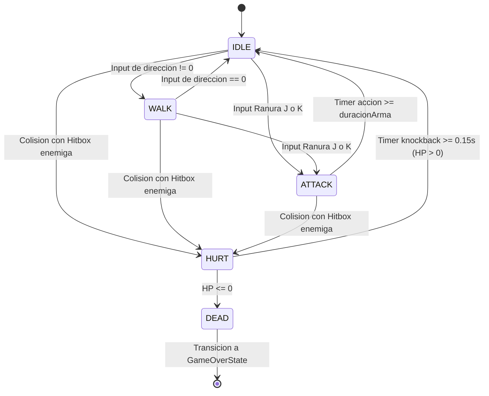

# Game Design & Technical Specification (Vertical Slice)

## 1. Concepto y Bucle Principal (*Core Loop*)

**Título provisional:** `[Nombre del Proyecto]`  
**Género:** Acción-Aventura 2D vista cenital (*Top-Down*), inspirado en *The Legend of Zelda: A Link to the Past*.  
**Premisa:** El jugador controla a un aventurero que debe explorar un bosque dividido en cuatro zonas interconectadas, conseguir su equipamiento (espada, arco y bombas), resolver mecanismos ambientales y derrotar al Caballero Corrompido que custodia el santuario.

### Bucle de Jugabilidad
```text
Explorar zona -> Obtener equipo en cofres -> Gestionar inventario (J/K) -> Resolver puzles y combatir enemigos -> Derrotar Mini-Jefe -> Victoria
```

---

## 2. Especificaciones Técnicas y Entorno (Java + Eclipse)

| Parámetro | Valor Especificado | Decisiones de Ingeniería |
| :--- | :--- | :--- |
| **Lenguaje y Entorno** | **Java 21 LTS** en **Eclipse IDE** | Proyecto estándar con carpetas `src/` y `res/` (*Source Folders*), sin dependencias externas pesadas. |
| **Motor de Renderizado** | **Java2D** (`BufferedImage` + `BufferStrategy`) | Control total del *Game Loop*, doble/triple búfer y renderizado por software determinista. |
| **Resolución Lógica** | $256 \times 224\text{ px}$ | Lienzo virtual interno (proporción clásica 8:7). |
| **Resolución de Ventana** | $768 \times 672\text{ px}$ | Escalado entero ($\times 3$) mediante `VALUE_INTERPOLATION_NEAREST_NEIGHBOR`. |
| **Tamaño Base de Celda (*Tile*)** | $16 \times 16\text{ px}$ | Cada pantalla visible muestra una rejilla de $16 \times 14$ *tiles*. |
| **Tasa de Refresco** | $60\text{ FPS}$ fijos | *Fixed timestep* ($\Delta t = 1/60\text{ s}$) en hilo dedicado (`Runnable`). |
| **Formato de Mapas** | `.json` / `.tmx` | Diseñados por capas y exportados desde **Tiled Map Editor**. |
| **Estilo y Paleta de Arte** | *Pixel Art* propio (máx. 32 colores) | Creado en **Aseprite / LibreSprite** con paleta unificada para personajes, enemigos y entorno. |

---

## 3. Mecánicas del Jugador, Inventario y Controles

### Mapeo de Controles
| Acción Lógica | Tecla Principal | Tecla Alternativa | Tipo de Pulsación |
| :--- | :--- | :--- | :--- |
| Mover Arriba / Abajo | `W` / `S` | `Flecha Arriba` / `Abajo` | Mantenida (*Held*) |
| Mover Izquierda / Derecha | `A` / `D` | `Flecha Izquierda` / `Derecha` | Mantenida (*Held*) |
| Usar Objeto Ranura A (Principal) | `J` | `Z` | Un solo frame (*Just Pressed*) |
| Usar Objeto Ranura B (Secundaria) | `K` | `X` | Un solo frame (*Just Pressed*) |
| Interactuar / Leer / Abrir Cofre | `E` | `Espacio` | Un solo frame (*Just Pressed*) |
| Abrir / Cerrar Inventario | `I` | `TAB` | Un solo frame (*Just Pressed*) |
| Pausar / Reanudar | `ESC` | `P` | Un solo frame (*Just Pressed*) |

### Constantes Físicas y de Combate
* **Velocidad de movimiento:** $80\text{ px/s}$ (vector normalizado $\vec{v} / \|\vec{v}\|$ en diagonales).
* **Salud inicial:** $6$ unidades ($3$ corazones completos; ampliable a $8$ unidades / $4$ corazones mediante Contenedor de Corazón).
* **Caja de colisión física (entorno):** $12 \times 8\text{ px}$ situada en los pies del *sprite* ($16 \times 16\text{ px}$).
* **Hurtbox (recepción de daño):** $12 \times 14\text{ px}$ centrada en el cuerpo del jugador.
* **Invulnerabilidad tras daño (*i-frames*):** $1.0\text{ s}$ con parpadeo visual cada $0.1\text{ s}$.
* **Retroceso (*Knockback*):** Impulso de $160\text{ px/s}$ durante $0.15\text{ s}$ en dirección opuesta al impacto.

### Sistema de Inventario y Armas (Patrón *Strategy*)
El jugador dispone de un **Inventario visual** (cuadrícula de $2 \times 4$ espacios) que pausa el mundo activo y permite inspeccionar objetos, consumir pociones o asignar armas a las ranuras rápidas **J** y **K**:

1. **Espada del Bosque (`SwordWeapon`):**
   * Ataque cuerpo a cuerpo frontal sin coste de munición.
   * Proyecta una *Hitbox* de $16 \times 12\text{ px}$ (horizontal) o $12 \times 16\text{ px}$ (vertical) durante $0.25\text{ s}$. Inflige $1$ punto de daño.
2. **Arco de Cazador (`BowWeapon`):**
   * Dispara una entidad dinámica `Projectile` (flecha) a $180\text{ px/s}$ en la dirección del jugador.
   * Consume $1$ flecha del carcaj (capacidad máxima: $20$). Inflige $1$ punto de daño y permite activar interruptores a distancia.
3. **Bombas (`BombWeapon`):**
   * Coloca una entidad `BombEntity` frente al jugador con temporizador de $2.0\text{ s}$.
   * Consume $1$ bomba (capacidad máxima: $10$). Explota en un área de $32 \times 32\text{ px}$, infligiendo $2$ puntos de daño y destruyendo muros agrietados.
4. **Objetos Consumibles y Clave:**
   * **Poción Roja:** Se consume directamente desde el inventario y restaura $4$ unidades de salud ($2$ corazones).
   * **Llave Pequeña:** Abre automáticamente puertas con cerradura al interactuar con ellas.

### Máquina de Estados Finitos (Jugador)


---

## 4. Enemigos, Mini-Jefe e Inteligencia Artificial

### 4.1. Slime del Bosque (Cuerpo a Cuerpo)
* **Salud:** $2\text{ HP}$ | **Daño por contacto:** $1$ unidad.
* **Velocidades:** Patrulla a $30\text{ px/s}$ | Persecución a $50\text{ px/s}$.
* **Comportamiento:** Patrulla aleatoriamente cada $1.5\text{ s}$. Si el jugador entra en un radio de $64\text{ px}$, pasa a `CHASE`; si se aleja a más de $96\text{ px}$, vuelve a `PATROL`.
* **Botín:** $50\%$ probabilidad de soltar un corazón ($+1\text{ HP}$).

### 4.2. Esqueleto Arquero (Combate a Distancia)
* **Salud:** $3\text{ HP}$ | **Daño por proyectil:** $1$ unidad.
* **Velocidad:** $35\text{ px/s}$.
* **Comportamiento:** Se desplaza buscando alinearse en el eje $X$ o $Y$ con el jugador dentro de un rango de $48\text{ px}$ a $112\text{ px}$. Al alinearse, detiene su movimiento durante $0.4\text{ s}$ (*telegrafiado*) y dispara una flecha (`Projectile`) con enfriamiento de $2.0\text{ s}$.
* **Botín:** $60\%$ probabilidad de soltar un lote de $3$ flechas.

### 4.3. Mini-Jefe: Caballero Corrompido (Guardián del Santuario)
* **Salud:** $12\text{ HP}$ | **Daño:** $2$ unidades ($1$ corazón completo).
* **Comportamiento (Máquina de Estados de Combate):**
  1. **`IDLE_GUARD`:** Avanza lentamente ($35\text{ px/s}$) hacia el jugador evaluando la distancia.
  2. **`TELEGRAPH` ($0.5\text{ s}$):** Se detiene y parpadea en color rojo/blanco avisando del ataque inminente.
  3. **`CHARGE`:** Si el jugador está lejos ($> 48\text{ px}$), embiste en línea recta a $135\text{ px/s}$ durante $0.6\text{ s}$.
  4. **`SPIN_ATTACK`:** Si el jugador está cerca ($\le 48\text{ px}$), ejecuta un tajo circular de $36 \times 36\text{ px}$ alrededor de su cuerpo.
  5. **Fase 2 ($HP \le 6$):** Su velocidad de movimiento aumenta un $25\%$ y el tiempo de `TELEGRAPH` se reduce a $0.35\text{ s}$.

---

## 5. Diseño del Mundo (4 Zonas Interconectadas)

El mapa tiene una dimensión total de **$32 \times 28$ *tiles* ($512 \times 448\text{ px}$)**, estructurado en cuatro cuadrantes interconectados que guían la progresión del jugador:

```text
+-------------------------------+-------------------------------+
| ZONA 1: CLARO INICIAL         | ZONA 2: SENDERO DEL BOSQUE    |
|                               |                               |
|  [P] Jugador                  |   [E] Slimes + Arqueros       |
|  [C1] Cofre: Espada           |   [B] Arbustos cortables      |
|  [S] Cartel con controles     |   [C2] Cofre: Arco + Flechas  |
|              ==== Puerta =====|=============                  |
+-------------------------------+-------------------------------+
| ZONA 3: ANTESALA MAZMORRA     | ZONA 4: CAMARA DEL GUARDIAN   |
|                               |                               |
|  [W] Abismo + Interruptor     |   [L] Puerta con cerradura    |
|  [C3] Cofre: Bombas           |   [BOSS] Caballero Corrompido |
|  [X] Muro agrietado -> [Key]  |   [C4] Cofre Final (Victoria) |
+-------------------------------+-------------------------------+
```

### Flujo de Progresión
1. **Claro Inicial:** Zona segura. El jugador lee el cartel inicial y abre el cofre `C1` para obtener la **Espada**.
2. **Sendero del Bosque:** Combate contra Slimes y Esqueletos Arqueros; al cortar arbustos y explorar, obtiene el **Arco** en `C2`.
3. **Antesala de la Mazmorra:** El jugador usa el Arco para activar un interruptor al otro lado de un abismo, desbloqueando el cofre `C3` con **Bombas**. Con una bomba destruye el muro agrietado para obtener la **Llave Pequeña**.
4. **Cámara del Guardián:** Abre la puerta con cerradura `L`. Las puertas se sellan hasta derrotar al **Caballero Corrompido**, momento en el que aparece el cofre final `C4` que otorga la victoria.

---

## 6. Lista Cerrada de Recursos (*Asset Checklist*)

### Gráficos (`res/sprites/`, formato `.png` transparente)
* [ ] `tileset_world.png` ($16 \times 16$ por *tile*): hierba, camino, suelo de piedra, muros, árboles, agua/abismo, muro agrietado, arbusto, interruptor (on/off), puertas.
* [ ] `player_sheet.png` ($16 \times 16$ por *frame*): caminar ($2$ *frames* $\times 4$ direcciones), atacar con espada ($2$ *frames* $\times 4$ direcciones) y apuntar arco ($1$ *frame* $\times 4$ direcciones).
* [ ] `weapons_projectiles.png` ($16 \times 16$): tajo de espada, flecha en 4 direcciones, bomba ($2$ *frames* mecha) y explosión ($3$ *frames* de $32 \times 32\text{ px}$).
* [ ] `enemies_sheet.png` ($16 \times 16$): Slime ($3$ *frames*) y Esqueleto Arquero ($4$ *frames*).
* [ ] `boss_knight.png` ($24 \times 24$ por *frame*): caminar, telegrafiar ataque, embestida y ataque circular.
* [ ] `ui_items.png` ($16 \times 16$ y $8 \times 8$): iconos de espada, arco, bomba, poción, llave, cofre cerrado/abierto, corazones (lleno, medio, vacío) y marco de inventario.

### Audio (`res/audio/`, formato `.wav` compatible con `javax.sound.sampled`)
* [ ] `sfx_sword.wav`, `sfx_bow.wav`, `sfx_bomb_fuse.wav`, `sfx_explosion.wav`.
* [ ] `sfx_hit.wav`, `sfx_player_hurt.wav`, `sfx_item_get.wav`, `sfx_door_open.wav`, `sfx_switch.wav`.
* [ ] `bgm_overworld.wav` (música de exploración en bucle) y `bgm_boss.wav` (música de combate contra jefe).

---

## 7. Fuera de Alcance (*Out of Scope*)

Para asegurar la finalización del proyecto dentro de un plazo realista, quedan **excluidos**:
* Sistema de economía, tiendas, compra/venta de objetos o recolección de monedas.
* Guardado y carga de partidas en disco (*Save/Load* o serialización).
* Diálogos ramificados con árboles de decisión o misiones secundarias.
* Múltiples niveles/mazmorras adicionales más allá de las 4 zonas definidas.
* Soporte para mando (*Gamepad*) o reasignación dinámica de controles.